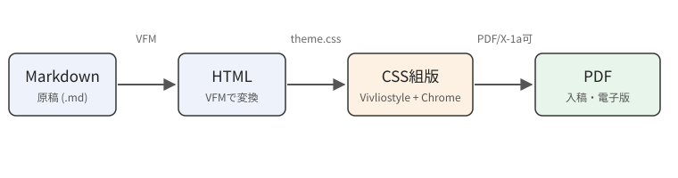

## 全体の流れ

原稿はVFM（Vivliostyle Flavored Markdown）というMarkdown方言で書きます。普通のMarkdownにルビや図のキャプション、属性指定などの拡張が加わったもので、GitHub上のMarkdownとほぼ同じ感覚で書けます。変換と組版はVivliostyle CLIが一括で行います（）。

{id="fig-pipeline"}

Vivliostyleは内部でChromeを使ってレイアウトし、そのうえで改ページやページフロート、柱やノンブルといった「本のための機能」を自前で実装しています。そのため、Chromeが対応しているCSSはほぼそのまま使え、さらに印刷向けのCSS（CSS Paged Media、GCPM）も使える、という二段構えになっています。
