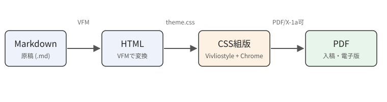

この章では、Markdownで書いた原稿をHTMLに変換し、CSSでページをデザインしてPDFにする流れを説明します。技術同人誌の世界では、ここ数年でこの方法がすっかり定番になりました。TeXの知識がなくても、Webの知識だけで本が作れるのが最大の魅力です。

## 全体の流れ

原稿はVFM（Vivliostyle Flavored Markdown）というMarkdown方言で書きます。普通のMarkdownにルビや図のキャプション、属性指定などの拡張が加わったもので、GitHub上のMarkdownとほぼ同じ感覚で書けます。変換と組版はVivliostyle CLIが一括で行います（[](#fig-pipeline)）。

{id="fig-pipeline"}

Vivliostyleは内部でChromeを使ってレイアウトし、そのうえで改ページやページフロート、柱やノンブルといった「本のための機能」を自前で実装しています。そのため、Chromeが対応しているCSSはほぼそのまま使え、さらに印刷向けのCSS（CSS Paged Media、GCPM）も使える、という二段構えになっています。

## プロジェクトの構成

このサンプルのファイル構成は次のとおりです。章ごとにディレクトリを分け、その中に章扉の原稿（`title.md`）と本文の原稿、画像を置きます。章はディレクトリ名の順に並び、名前の先頭の数字がそのまま章番号になります。

```text:ディレクトリ構成
techbook/
├── vivliostyle.config.js   … 判型・出力先
├── lib/chapters.js         … 章ディレクトリを1章にまとめる
├── theme/
│   ├── book.css            … デザインはすべてここ
│   └── print.css           … 入稿用のトンボと塗り足し
└── manuscript/
    ├── 01-intro/           … 1章＝1ディレクトリ
    │   ├── title.md        … 章扉
    │   ├── body.md         … 本文
    │   └── images/
    ├── 02-images/
    └── 03-linebreak/
```

本文は1つのファイルにまとめても、節ごとに`01-flow.md`、`02-structure.md`のように分けてもかまいません。`title.md`の後ろにファイル名の順でつなげてから組むので、節番号や図番号は章の中で通しになります。

設定ファイルでは判型や出力先を指定します。技術書典などの即売会ではB5判が主流なので、`JIS-B5`を指定しています。出力は2種類で、印刷所に入稿するトンボ付きのPDFと、電子版として配布するトンボなしのPDFを一度に書き出します。

```js:vivliostyle.config.js（抜粋）
const common = {
  title: 'CSS組版で作る技術同人誌',
  language: 'ja',
  size: 'JIS-B5',
  // manuscript/ の下の章ディレクトリを名前の順に並べる
  entry: chapterEntries('manuscript', { root }),
};
export default defineConfig([
  // 入稿用：トンボ＋塗り足し3mm（print.css）
  { ...common, theme: ['theme/book.css', 'theme/print.css'],
    output: 'output/book-print.pdf' },
  // 電子版：トンボなし
  { ...common, theme: 'theme/book.css',
    output: 'output/book-ebook.pdf' },
]);
```

トンボと塗り足しは`theme/print.css`の3行で指定しています。`bleed: 3mm`で仕上がり線の外側に上下左右3mmの塗り足しが付き、`marks: crop cross`で角トンボとセンタートンボが描かれます。

```css:theme/print.css
@page {
  size: 182mm 257mm;   /* 仕上がりサイズ（B5） */
  marks: crop cross;   /* 角トンボ＋センタートンボ */
  bleed: 3mm;          /* 塗り足し 上下左右3mm */
}
```

## ビルドとプレビュー

コマンドは二つだけ覚えれば十分です。`npm run preview`でブラウザにプレビューが開き、MarkdownやCSSを保存するたびに自動で再描画されます。`npm run build`で入稿用と電子版の2つのPDFが出力されます。

```bash
npm run preview   # ライブプレビュー（保存すると即反映）
npm run build     # 入稿用（トンボ付き）と電子版のPDFを生成
```

プレビューでレイアウトを確認しながらCSSを調整し、最後にPDFを書き出す、というのが基本のサイクルです。CSSの調整にはChromeの開発者ツールもそのまま使えます。
