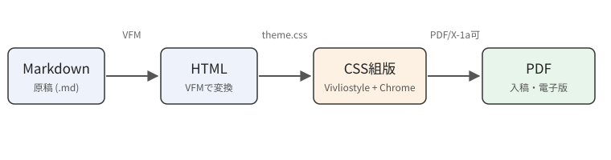
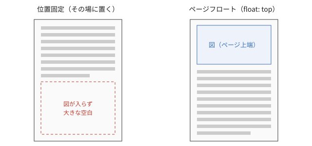
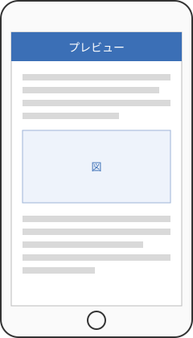

# 画像の配置を制御する

CSS組版で最初につまずくのが画像の位置です。Webページと違って紙面には「ページの終わり」があるので、大きな図がページ末尾に入りきらないと、図ごと次のページに送られて大きな空白ができてしまいます。この章では、Markdown側にクラスを一つ付けるだけで配置を切り替えられるようにする方法を紹介します。

## 基本の書き方

VFMでは、画像を単独の行に書くと`<figure>`と`<figcaption>`に変換されます。代替テキストがそのままキャプションになり、図番号はCSSのカウンターで自動的に振られます。

```md
{id="fig-pipeline"}

本文中で参照するときは（[](#fig-pipeline)）と書く
```

参照用のリンクは中身を空にしておき、CSSの`target-counter()`で「図1.1」のような番号を差し込みます。図の順番を入れ替えても番号と参照が自動で追従するので、手で番号を振り直す必要はありません。

## 配置を切り替えるクラス

画像の後ろに`{class="…"}`を付けると``にクラスが付きます。CSS側では`figure:has(> img.top)`のように「そのクラスの画像を含む図」を選び、図全体の配置を変えます。このサンプルのテーマでは次のクラスを用意しました。表やコードなど画像以外のものは`<div class="top">`で囲めば同じように送れます。

<div class="top">

| クラス | 配置 | 主な用途 |
|---|---|---|
| （なし） | その場に置く | 小さな図、位置が重要な図 |
| `top` | ページの上端へ送る | 大きな図・表（一番よく使う） |
| `bottom` | ページの下端へ送る | 補足的な図 |
| `right` / `left` | 本文を回り込ませる | 縦長のスクリーンショット |
| `newpage` | 改ページして置く | 見開きで見せたい大きな図 |
| `w30`〜`w80` | 幅を指定する | 上のクラスと組み合わせ可 |

</div>

## ページフロートで空白をなくす

`top`クラスを付けた図は、Vivliostyleのページフロート機能（`float: top`と`float-reference: page`）によって、そのページの上端に配置されます。今いるページに入りきらない場合は次のページの上端に送られ、その間も本文は途切れずに流れ続けます。LaTeXの`[t]`指定とほぼ同じ挙動です（[](#fig-float)）。

```md
{id="fig-float" class="top w80"}
```

{id="fig-float" class="top w80"}

左のように「その場」に置くと、図が入りきらないときにページ下部が空いてしまいます。右のようにページフロートにすれば、図はページの上端に移動し、空いた場所には後続の本文が流し込まれます。原稿のどこに画像を書いたかと、紙面のどこに出るかが少しずれますが、本文から図番号で参照していれば読者が迷うことはありません。

技術書では、図や表、長いコードはできるだけページフロートにしておき、どうしても本文のその位置に置きたいものだけを「その場」にする、という方針が扱いやすいでしょう。章の最後で図が次の章にはみ出さないように、章の先頭で`clear`をかけておくのもポイントです。

## 本文を回り込ませる

縦長のスクリーンショットは、ページ幅いっぱいに置くと間延びします。`right`クラスを付けると図が右に寄り、空いた左側に本文が回り込みます（[](#fig-screen)）。幅は`w30`などのクラスで指定します。

{id="fig-screen" class="right w30"}

回り込みは通常のCSSの`float: right`なので、Webページと同じ感覚で扱えます。ただし、回り込んだ状態でページをまたぐと見た目が崩れやすいので、図の高さが残りのスペースより大きくなりそうなときは、図を書く位置を一段落前にずらすのが確実です。

回り込みの横に見出しが来ると窮屈になるので、見出しには`clear: both`を指定して、図の下から始まるようにしておきます。また、回り込み部分の行頭が揃わず読みにくくなる場合は、段落の字下げを調整するとよいでしょう。キャプションは図の幅に合わせて折り返されるので、短めに書くのがコツです。

## 細かい調整のコツ

それでも思いどおりにならないときは、次のような手を順に試します。

1. 画像を書く位置を前後の段落に移動する（いちばん簡単で確実）
2. `top`と`bottom`を切り替えてみる
3. 幅のクラスを変えて図を小さくする
4. 最終手段として、直前に`<div class="pagebreak"></div>`を置いて強制的に改ページする

組版の最終段階では、原稿の内容を確定させてから、ページ順に頭から見ていって図の位置を微調整していきます。前のページを直すと後ろのページがすべてずれるので、必ず前から順に直すのが鉄則です。
