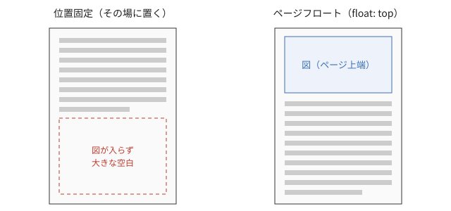

## ページフロートで空白をなくす

`top`クラスを付けた図は、Vivliostyleのページフロート機能（`float: top`と`float-reference: page`）によって、そのページの上端に配置されます。今いるページに入りきらない場合は次のページの上端に送られ、その間も本文は途切れずに流れ続けます。LaTeXの`[t]`指定とほぼ同じ挙動です（[](#fig-float)）。

```md
{id="fig-float" class="top w80"}
```

{id="fig-float" class="top w80"}

左のように「その場」に置くと、図が入りきらないときにページ下部が空いてしまいます。右のようにページフロートにすれば、図はページの上端に移動し、空いた場所には後続の本文が流し込まれます。原稿のどこに画像を書いたかと、紙面のどこに出るかが少しずれますが、本文から図番号で参照していれば読者が迷うことはありません。

技術書では、図や表、長いコードはできるだけページフロートにしておき、どうしても本文のその位置に置きたいものだけを「その場」にする、という方針が扱いやすいでしょう。章の最後で図が次の章にはみ出さないように、章の先頭で`clear`をかけておくのもポイントです。
