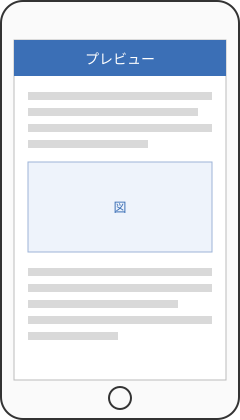

## 本文を回り込ませる

縦長のスクリーンショットは、ページ幅いっぱいに置くと間延びします。`right`クラスを付けると図が右に寄り、空いた左側に本文が回り込みます（）。幅は`w30`などのクラスで指定します。

{id="fig-screen" class="right w30"}

回り込みは通常のCSSの`float: right`なので、Webページと同じ感覚で扱えます。ただし、回り込んだ状態でページをまたぐと見た目が崩れやすいので、図の高さが残りのスペースより大きくなりそうなときは、図を書く位置を一段落前にずらすのが確実です。

回り込みの横に見出しが来ると窮屈になるので、見出しには`clear: both`を指定して、図の下から始まるようにしておきます。また、回り込み部分の行頭が揃わず読みにくくなる場合は、段落の字下げを調整するとよいでしょう。キャプションは図の幅に合わせて折り返されるので、短めに書くのがコツです。
